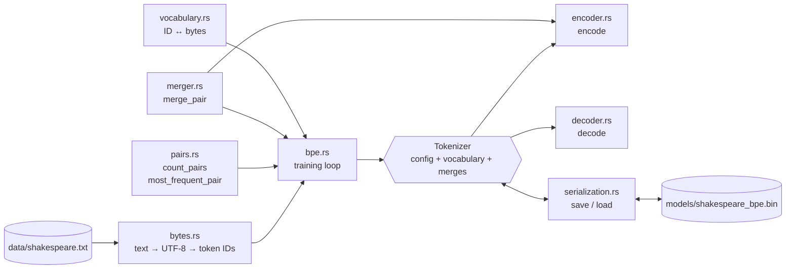
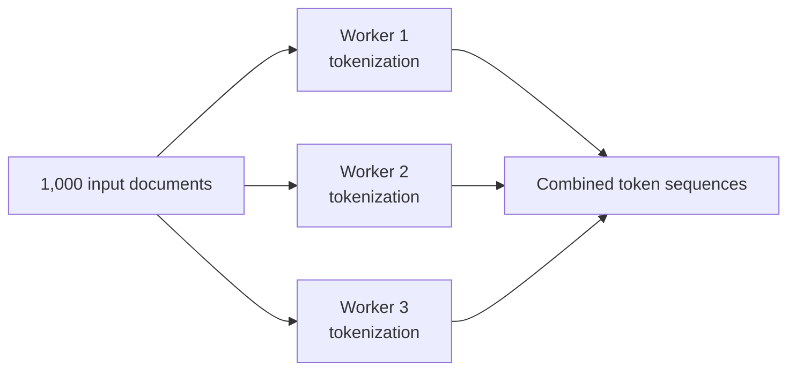

<h1 align="center">Rust BPE</h1>

<p align="center">
  <picture>
    <source media="(prefers-reduced-motion: reduce)" srcset="assets/tokenizer-demo-static.svg">
    
  </picture>
</p>

<p align="center">
  <em>An educational byte-level BPE tokenizer in Rust, trained on Tiny Shakespeare.</em><br>
  Standard library only · no <code>unsafe</code> · 65 tests · versioned binary model format
</p>

<p align="center"><sub>If the animation does not play, see the <a href="assets/tokenizer-demo-static.svg">static diagram</a>.</sub></p>

---

## Contents

- [About](#about)
- [Goals](#goals)
- [Features](#features)
- [Architecture](#architecture)
- [Directory structure](#directory-structure)
- [Technology stack](#technology-stack)
- [Getting started](#getting-started)
- [Usage](#usage)
- [Example output](#example-output)
- [Performance results](#performance-results)
- [Rust and C++](#rust-and-c)
- [Systems-engineering perspective](#systems-engineering-perspective)
- [Limitations](#limitations)
- [Roadmap](#roadmap)
- [License](#license)

## About

A **tokenizer** converts text into a sequence of integers (token IDs) that a language model can process. **Byte Pair Encoding (BPE)** builds a vocabulary of tokens. It starts from the 256 possible byte values. Then it repeatedly merges the most frequent adjacent pair of tokens into one new token.

rust_bpe implements every step of this algorithm from first principles: reading the corpus, the UTF-8 byte representation, pair counting, merging, training, encoding, decoding, and saving the model to a binary file. Each step has unit tests and a detailed explanation in [`report.md`](report.md).

## Goals

1. Learn Rust through a real, CPU-bound systems problem.
2. Understand BPE exactly, without a library to hide the details.
3. Keep the code small, readable and fully tested.
4. Measure performance honestly before we optimize.

## Features

- **Byte-level BPE.** Any UTF-8 text can be encoded, in any language. The initial vocabulary is the 256 byte values.
- **Deterministic training.** If two pairs have the same count, the smaller pair wins. The same input always gives the same merges.
- **Ordered merge rules.** Each rule stores its left ID, right ID, new ID and the frequency at training time.
- **Exact round trip.** `decode(encode(text)) == text` for all valid UTF-8 text. The tests check this property.
- **Error handling with `Result`.** Unknown token IDs, invalid UTF-8, missing files and corrupted model files return errors. They do not cause a panic.
- **Versioned binary model format.** It has a magic header and explicit little-endian integer widths. Every length is validated before memory is allocated.
- **Standard-library benchmark harness** with warm-up iterations and min / median / mean / max statistics.

## Architecture



The training loop, in `src/tokenizer/bpe.rs`:

```text
tokens = UTF-8 bytes of the corpus          vocabulary = 256 byte tokens
repeat until a stop condition:
    counts       = count_pairs(tokens)       stop if no pairs
    (pair, freq) = most_frequent_pair(counts)
    new_id       = vocabulary.add_merge(pair)   ← 256, 257, 258, ...
    tokens       = merge_pair(tokens, pair, new_id)
    merges.push(MergeRule { pair, new_id, freq })
```

## Directory structure

```text
rust_tokenizer/
├── Cargo.toml                 package manifest (no dependencies)
├── src/
│   ├── main.rs                train → save → demo encode/decode
│   ├── lib.rs                 library root
│   └── tokenizer/
│       ├── mod.rs             module declarations
│       ├── pre_tokenizer.rs   whitespace splitting (not used by training)
│       ├── bytes.rs           text ↔ UTF-8 bytes ↔ token IDs
│       ├── pairs.rs           adjacent pair counting and selection
│       ├── merger.rs          non-overlapping pair replacement
│       ├── vocabulary.rs      TokenId and the ID → bytes table
│       ├── bpe.rs             TrainingConfig, MergeRule, train, Tokenizer
│       ├── encoder.rs         text → token IDs
│       ├── decoder.rs         token IDs → text
│       └── serialization.rs   binary save / load with validation
├── tests/tokenizer_tests.rs   integration tests (round trips)
├── examples/basic_encoding.rs loads the saved model; no training
├── benches/bpe_benchmarks.rs  std-only benchmark harness
├── data/shakespeare.txt       Tiny Shakespeare corpus (1,115,394 bytes)
├── models/                    saved tokenizer (created by cargo run)
├── reports/benchmark_results.md
├── assets/                    README visuals
└── report.md                  complete educational report
```

## Technology stack

| Component | Choice |
|---|---|
| Language | Rust, edition 2024 |
| Toolchain used for development | rustc 1.99.1, stable, `x86_64-pc-windows-msvc` |
| Dependencies | none (only `std`) |
| Tests | built-in `cargo test` |
| Benchmarks | custom harness with `std::time::Instant` (`harness = false`) |
| Formatting | `rustfmt` |
| Dataset | [Tiny Shakespeare](https://github.com/karpathy/char-rnn/tree/master/data/tinyshakespeare) |

## Getting started

### Installation

1. Install Rust with [rustup](https://rustup.rs).
2. Clone the repository and go into it.
3. Download the corpus, if `data/shakespeare.txt` is not present:

   ```sh
   mkdir -p data
   curl -fsSL -o data/shakespeare.txt \
     https://raw.githubusercontent.com/karpathy/char-rnn/master/data/tinyshakespeare/input.txt
   ```

### Build

```sh
cargo build --release
cargo test
```

Use `--release` for training. The debug build was about 18 times slower in our test (41 s compared with 2.3 s for the complete program).

## Usage

### Train and save

```sh
cargo run --release
```

This command does these steps:

1. It trains on `data/shakespeare.txt` until the vocabulary has 512 tokens.
2. It prints progress every 25 merges.
3. It prints the first 20 merge rules.
4. It saves the model to `models/shakespeare_bpe.bin`.
5. It encodes and decodes a demo sentence.

To change the settings, edit `TrainingConfig` in `src/main.rs`:

```rust
let config = TrainingConfig {
    target_vocab_size: 1024,
    max_merges: Some(500),
    ..TrainingConfig::default()
};
```

### Encode and decode

```rust
use rust_tokenizer::tokenizer::bpe::{Tokenizer, TrainingConfig, train};

let config = TrainingConfig::default();
let result = train("banana bandana", &config);
let tokenizer = Tokenizer { config, vocabulary: result.vocabulary, merges: result.merges };

let ids: Vec<u32> = tokenizer.encode("banana");
let text: String = tokenizer.decode(&ids)?;   // Err(DecodeError) for unknown IDs or invalid UTF-8
assert_eq!(text, "banana");
```

### Save and load

```rust
use std::path::Path;
use rust_tokenizer::tokenizer::serialization::{load, save};

save(&tokenizer, Path::new("models/my_tokenizer.bin"))?;
let restored = load(Path::new("models/my_tokenizer.bin"))?;   // no retraining
assert_eq!(restored, tokenizer);
```

The example program loads the saved model in a new process and round-trips any text:

```sh
cargo run --release --example basic_encoding -- "Now is the winter of our discontent."
```

### Benchmarks

```sh
cargo bench
```

The full results and the method are in [`reports/benchmark_results.md`](reports/benchmark_results.md).

## Example output

`cargo run --release` (the progress lines are not shown):

```text
Training complete.
Stop reason:           TargetVocabSizeReached
Merges completed:      256
Final vocabulary size: 512
Corpus size (bytes):   1115394
Final token count:     568210

First 20 merge rules:
 1: (101,  32) -> 256 "e "  frequency 27643
 2: (116, 104) -> 257 "th"  frequency 22739
 3: (116,  32) -> 258 "t "  frequency 16508
 4: (115,  32) -> 259 "s "  frequency 15364
 5: (100,  32) -> 260 "d "  frequency 14165
 6: ( 44,  32) -> 261 ", "  frequency 14098
 ...
18: ( 32, 257) -> 273 " th"  frequency 6662

Saved tokenizer to:    models/shakespeare_bpe.bin

Original text:   "To be, or not to be, that is the question."
Character count: 42
Byte count:      42
Encoded IDs:     [418, 98, 302, 268, 32, 327, 283, 98, 302, 361, 279, 295, 461, 280, 116, 412, 46]
Token count:     17
Decoded text:    "To be, or not to be, that is the question."
Round trip:      OK
```

Load in a new process. Text that is not ASCII falls back to single bytes:

```text
$ cargo run --release --example basic_encoding -- "café, naïve — 日本語 🦀"
Loaded tokenizer from: models/shakespeare_bpe.bin
Vocabulary size:       512
Merge rules:           256
Original text: "café, naïve — 日本語 🦀"
Byte count:    32
Token count:   28
Round trip:    OK
```

## Performance results

Measured with `cargo bench` on an AMD Ryzen 7 6800H (8 cores / 16 threads), Windows 11, rustc 1.99.1, release profile, single thread. These are medians. The complete tables, the method and the limitations are in [`reports/benchmark_results.md`](reports/benchmark_results.md).

| Operation | Input | Median time | Throughput |
|---|---|---|---|
| Train to 512 tokens | 1,115,394 bytes | 2.165 s | 8.46 ms per merge |
| Encode | 42-byte sentence | 47.3 µs | 0.89 MB/s |
| Encode | 100 KB | 14.66 ms | 6.82 MB/s |
| Encode | full corpus | 383.7 ms | 2.91 MB/s |
| Decode | full corpus | 4.32 ms | 258 MB/s |
| Save model | 10,247-byte file | 0.50 ms | — |
| Load model | 10,247-byte file | 75.1 µs | — |

**Compression:** 1,115,394 bytes → 568,210 tokens = **1.963 bytes per token** (a 49.1% shorter sequence).

These numbers are a **baseline** for a deliberately naive implementation. They are not the result of an optimized tokenizer.

## Rust and C++

This project uses Rust. That choice does **not** mean that Rust is faster than C++. Both languages compile to native machine code. With equal algorithms and equal effort, their performance is usually similar. The algorithm and the implementation control the speed more than the language does. **We did not compare rust_bpe with a C++ implementation. Thus, this repository makes no claim about relative speed.**

**What Rust gives this project:**

| Property | What it means here |
|---|---|
| Memory safety without a garbage collector | Memory is freed at a known point, when its owner goes out of scope. No collector runs in the background. |
| Ownership and borrowing | `pre_tokenize` returns `Vec<&str>` slices into the corpus. The compiler proves that they cannot outlive the corpus. |
| Data-race prevention | In safe Rust, the type system (`Send`, `Sync`, borrowing rules) rejects unsynchronized shared mutation at compile time. This is useful for future parallel encoding. |
| Strong compile-time checks | Exhaustive `match` on `Option`, `Result` and our error enums. Integer conversions such as `u32::try_from` must be explicit. |
| Native compilation | `cargo build --release` produces an optimized native binary through LLVM. |
| Cargo | Build, test, bench, format and documentation with one tool. The project has zero dependencies. |
| Explicit error handling | `Result<T, E>` and `?`. A failure is part of the function signature. |

**What C++ gives:**

1. C++ also produces high-performance native code. Its optimizing compilers are mature.
2. C++ gives extensive and direct control over memory layout and allocation.
3. C++ has decades of mature systems libraries. Many production tokenizers and inference engines are written in C++.
4. Modern C++ has RAII, smart pointers and move semantics. These prevent many memory errors in practice. The difference is that Rust's compiler enforces its rules by default, while in C++ the programmer and tools must enforce them.

**Why Rust is a good choice for this educational project:** the compiler explains ownership and lifetime errors when you make them. Thus, the memory model becomes something that you practice, not only something that you read about. And with the standard library alone, you can build the complete pipeline, its tests and its benchmarks.

## Systems-engineering perspective

### 1. Why tokenizers are CPU-intensive

A tokenizer that processes a large text corpus does these operations:

- It reads millions of bytes.
- It converts UTF-8 text into byte sequences.
- It splits text into chunks.
- It counts adjacent pairs.
- It looks up vocabulary entries.
- It merges token sequences.
- It allocates and releases memory.
- It encodes and decodes token IDs.

During LLM inference, tokenization can also become a bottleneck when many requests arrive at the same time. The GPU can process tokens very quickly, but the CPU must prepare those tokens before they go into the model.

**In rust_bpe:** training makes 256 passes over a sequence of 1.1 million tokens. It takes 2.165 s. Pair counting is about 82% of that time (a derived estimate).

### 2. Where Rust becomes interesting: memory management

The main difference is not that Rust uses less memory than C++. The difference is how Rust manages memory and how it prevents invalid memory operations. Consider three common problems.

**A. Memory leaks.** In C++, you can allocate memory manually:

```cpp
int* data = new int[1000];
// Forgot to release memory
```

If the program does not release the memory, it can stay allocated. Rust uses ownership rules:

```rust
{
    let data = vec![1, 2, 3, 4, 5];
} // `data` goes out of scope here, and Rust frees its memory.
```

There is no garbage collector running in the background. This is useful because tokenizers can process large amounts of text: memory release is predictable when many requests are processed. (Note: safe Rust can still leak memory on purpose with `Box::leak`, or by accident with reference cycles of `Rc`. Ownership makes leaks rare. It does not make them impossible.)

**B. Dangling pointers.** A dangling pointer refers to memory that is no longer valid. C++ lets programmers create such situations. Rust's borrowing rules prevent a reference from outliving the data that it refers to:

```rust
let text = String::from("hello");
let reference = &text;
```

- `text` owns the string.
- `reference` borrows the string. It does not own or copy the string.
- The compiler checks that `reference` stays valid.

**C. Data races.** Suppose that several CPU threads process different sections of a corpus. Two threads might try to change the same memory location. This can cause a data race. In safe Rust, the ownership and type systems prevent data races. This is useful for parallel tokenization pipelines.

### 3. The biggest advantage: zero-copy processing

This point applies directly to rust_bpe. `src/tokenizer/pre_tokenizer.rs` does exactly this:

```rust
let text = String::from("hello world");
let words: Vec<&str> = text.split_whitespace().collect();
```

1. `text` owns the original string.
2. `split_whitespace()` creates references to sections of that string.
3. `collect()` stores those references in a vector.
4. The original string stays the owner of the text.

No new `String` is created for each word. Compare with this code:

```rust
let words: Vec<String> = text
    .split_whitespace()
    .map(|word| word.to_string())
    .collect();
```

This code creates a separate owned string for each word.

```text
Approach 1: borrowed slices (&str)          Approach 2: owned strings (String)

text ──► [h e l l o _ w o r l d]            text ──► [h e l l o _ w o r l d]
           ▲         ▲                       "hello" ──► [h e l l o]     new allocation
           │         │                       "world" ──► [w o r l d]     new allocation
  words: ["hello", "world"]
  no allocation for each word
```

Zero-copy is not automatic for every Rust operation. You must choose APIs and data structures that support borrowing. In rust_bpe, `text_to_bytes` (`&str → &[u8]`), `Vocabulary::get` (`→ Option<&[u8]>`) and the serialization `Reader` (`take → &[u8]`) all borrow and do not copy.

### 4. Rust and C++: the memory perspective

| Feature | Rust | C++ |
|---|---|---|
| Garbage collector | Not required | Not required |
| Memory management | Ownership and RAII | RAII and manual management |
| Dangling references | Prevented in safe Rust | Possible |
| Memory leaks | Still possible | Possible |
| Data races | Prevented in safe Rust | Possible |
| Zero-copy processing | Supported | Supported |
| Manual memory control | Available through `unsafe` Rust | Extensive |
| Memory overhead | No mandatory GC overhead | No mandatory GC overhead |

Remember that C++ also has RAII, smart pointers, move semantics and excellent memory management. The advantage of Rust is that its compiler enforces many memory-safety rules.

### 5. Why this matters for BPE

Our training pipeline repeatedly processes sequences of token IDs. A naive implementation does these steps:

1. It allocates a new vector for every merge.
2. It copies the entire sequence.
3. It builds the pair-frequency `HashMap` again.
4. It releases the previous sequence.
5. It repeats.

**This is exactly what rust_bpe does today.** `merge_pair` returns a new `Vec`, and `train` calls `count_pairs` on the full sequence for each merge. It is easy to read and easy to test. It is also the measured bottleneck. If you do this hundreds or thousands of times on a large corpus, allocation and copying become expensive.

Rust gives tools to improve this:

| Rust feature | Possible tokenizer application |
|---|---|
| `&[u8]` | Read byte sequences without a copy |
| `Vec<u32>` | Store token IDs efficiently |
| `HashMap` | Keep pair-frequency counts |
| `Vec::with_capacity()` | Reduce repeated allocations |
| `iter()` | Read collections without taking ownership |
| `iter_mut()` | Change elements through mutable references |
| `Arc<T>` | Share immutable data across threads |
| `rayon` (crate) | Parallel processing |

**`u32` compared with `usize` for token IDs.** On a 64-bit system, `usize` is usually 8 bytes and `u32` is 4 bytes. For a sequence of 100 million token IDs:

| Type | Approximate memory |
|---|---|
| `usize` | 800 MB |
| `u32` | 400 MB |

This is a 50% reduction in the memory of the token-ID array, if the vocabulary fits in the `u32` range. rust_bpe already uses `pub type TokenId = u32;` (in `src/tokenizer/vocabulary.rs`). You must also count the `HashMap`s, the vector capacities and the other data structures.

### 6. Where Rust can help with parallel tokenization

Consider a production system that receives 1,000 documents. We can distribute the independent documents across CPU threads:



Rust has strong support for this, through its threading model and libraries such as Rayon. But there are two different workloads:

- **BPE training.** The global pair frequencies control the merge decisions. Parallel training requires careful aggregation and synchronization.
- **BPE inference (encoding).** After the merge rules are learned, independent text chunks or documents can often be encoded in parallel.

The second workload is usually easier to parallelize. In rust_bpe, `Tokenizer::encode` takes `&self` and does not change the tokenizer. Thus, several threads can share one tokenizer.

### 7. Proposed experiments

We will use rust_bpe as a small performance-engineering experiment. The current implementation is the baseline ([`reports/benchmark_results.md`](reports/benchmark_results.md)). Then we will run these experiments:

| # | Experiment | Status |
|---|---|---|
| 1 | `String` compared with `&str` | planned |
| 2 | `Vec<usize>` compared with `Vec<u32>` | planned (the baseline uses `u32`) |
| 3 | Repeated allocations compared with preallocated vectors | planned |
| 4 | Cloning compared with borrowing | planned |
| 5 | Standard `HashMap` compared with other data structures | planned |
| 6 | Sequential compared with parallel encoding | planned |
| 7 | Naive pair counting compared with optimized pair tracking | planned |

Measure both the execution time and the memory use. Do not assume that an optimization works. Measure it.

### 8. The bigger picture

A tokenizer is a good systems-programming exercise for learning Rust, because it touches several important areas:

- CPU-bound algorithms
- Memory allocation
- Cache locality
- UTF-8 processing
- Data structures
- Ownership and borrowing
- Parallel processing
- Serialization
- Performance profiling

These concepts also apply to LLM inference engines, KV-cache management, tensor memory management and distributed systems.

**Next experiment:** before we move to a production tokenizer, we will profile the current implementation for memory allocations and peak memory use. Then we will optimize it step by step and compare the results. This teaches more about Rust's memory model than reading about ownership and borrowing.

## Limitations

1. **Naive algorithms.** Training and encoding cost O(merges × sequence length). Each pass allocates a new `Vec`.
2. **No pre-tokenization during training.** Training uses one byte sequence for the whole corpus. Thus, merges can cross word boundaries (for example `"e "` and `" th"`). `pre_tokenizer.rs` exists but training does not use it.
3. **Single-threaded.**
4. **The encoder applies every rule in order**, also rules whose pair does not occur in the input.
5. **`Vocabulary::id_of` is a linear scan.** This is acceptable for 512 tokens. It is slow for large vocabularies.
6. **No special tokens** (for example `<|endoftext|>`) and no regex pre-tokenizer, as GPT-style tokenizers have.
7. **Memory use is not measured yet.**
8. **`train` prints progress messages** from library code.
9. **The benchmarks come from one laptop**, with a simple harness. See the limitations section of the benchmark report.

## Roadmap

- [x] Corpus acquisition and validation
- [x] Pre-tokenizer, UTF-8 byte layer, pair counting, merging, vocabulary
- [x] Complete training loop with configurable stop conditions
- [x] Encoder and decoder with exact round trips
- [x] Versioned binary serialization with validation
- [x] Baseline benchmarks and report
- [ ] Profile memory allocations and peak memory
- [ ] Incremental pair-count updates during training
- [ ] In-place merging and buffer reuse
- [ ] Rank-based encoding (merge the lowest-rank pair present)
- [ ] Train on pre-tokenized words with counts
- [ ] Parallel encoding of independent documents
- [ ] Special tokens and a regex pre-tokenizer

## License

No license has been chosen yet, and this repository has no `LICENSE` file. Until a license is added, normal copyright applies. Many Rust projects use a dual MIT / Apache-2.0 license.

The Tiny Shakespeare dataset comes from Andrej Karpathy's [char-rnn](https://github.com/karpathy/char-rnn) repository. The text of Shakespeare's works is in the public domain.
