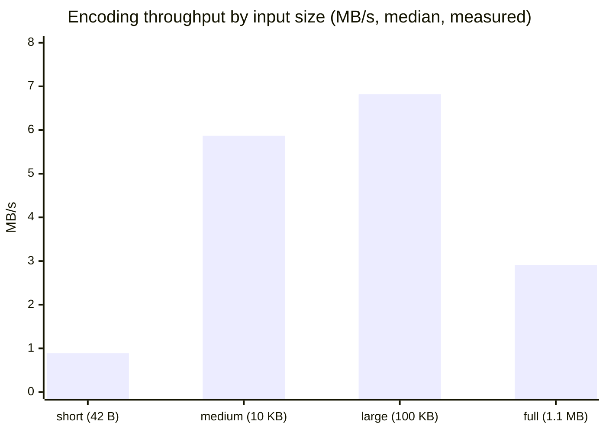

# rust_bpe benchmark results

All numbers in this report come from one `cargo bench` run on 2026-10-30.
The source of the benchmarks is `benches/bpe_benchmarks.rs`.

Labels used in this report:

- **Measured**: the harness printed this value.
- **Derived**: calculated from measured values with simple arithmetic.
- **Hypothesis**: a possible explanation. It was not tested.

---

## 1. Executive summary

1. Training on the full Tiny Shakespeare corpus (1,115,394 bytes) to a vocabulary of 512 tokens takes **2.165 s** (median of 5 runs, measured).
2. One merge step costs about **8.46 ms** (derived: median / 256 merges).
3. Encoding speed is between **0.89 MB/s and 6.82 MB/s** (measured). It depends on the input size.
4. Decoding is about **40 to 90 times faster** than encoding (derived). For example, the full corpus decodes in 4.318 ms and encodes in 383.7 ms.
5. The saved model is **10,247 bytes**. It loads from a file in **75.1 µs** (median, measured).
6. The 512-token vocabulary compresses the corpus from 1,115,394 bytes to **568,210 tokens**. This is **1.963 bytes per token** (measured), or a 49.06% reduction in sequence length.
7. The main bottleneck is the naive design. Training and encoding make one full pass over the sequence for each merge rule.

## 2. Hardware and software environment

| Item | Value | Source |
|---|---|---|
| CPU | AMD Ryzen 7 6800H with Radeon Graphics | Windows CIM (`Win32_Processor`) |
| Cores / logical CPUs | 8 / 16 | Windows CIM; the harness also reports 16 |
| Base clock (reported) | 3201 MHz | Windows CIM `MaxClockSpeed` |
| RAM | 15.2 GB | Windows CIM |
| Operating system | Windows 11 Home Single Language (10.0.26200) | Windows CIM |
| Architecture | x86_64 | `std::env::consts::ARCH` |
| Rust compiler | rustc 1.99.1 (58cf8f9c3 2026-10-13), LLVM 23.1.1 | `rustc -vV` |
| Cargo | cargo 1.99.1 (5f94df478 2026-08-27) | `cargo -V` |
| Toolchain | stable-x86_64-pc-windows-msvc | `rustup show active-toolchain` |
| Build profile | `bench` (release optimizations, `opt-level = 3`) | Cargo default |
| Dependencies | none (standard library only) | `Cargo.toml` |
| Threads used by the tokenizer | 1 | The implementation is single-threaded. |

The machine is a laptop. Other programs were running during the test. CPU frequency scaling was not controlled.

## 3. Dataset

| Item | Value |
|---|---|
| File | `data/shakespeare.txt` |
| Source | `https://raw.githubusercontent.com/karpathy/char-rnn/master/data/tinyshakespeare/input.txt` |
| Size | 1,115,394 bytes |
| Lines | 40,000 |
| Characters | 1,115,394 (the file is pure ASCII) |
| Unique byte values | 65 |
| SHA-256 | `86c4e6aa9db7c042ec79f339dcb96d42b0075e16b8fc2e86bf0ca57e2dc565ed` |

The encoding samples are prefixes of this corpus:

| Sample | Bytes | Content |
|---|---|---|
| short sentence | 42 | `"To be, or not to be, that is the question."` |
| medium | 10,000 | first 10,000 bytes of the corpus |
| large | 100,000 | first 100,000 bytes of the corpus |
| full corpus | 1,115,394 | the complete corpus |

The medium, large and full samples are part of the training text. The short sentence does not occur in the corpus.

## 4. Benchmark methodology

1. The command is `cargo bench`. Cargo builds the `bench` profile, which has release optimizations.
2. The harness uses only the standard library (`std::time::Instant`, `std::hint::black_box`). It does not use Criterion. Section 13 gives the reason.
3. The harness reads the corpus one time, before any timing starts. File read time and download time are not included.
4. Compilation time is not included. Cargo compiles before the harness starts.
5. Each benchmark first runs **warm-up iterations**. They are not measured.
6. Then each benchmark runs **measured iterations**. The harness records the time of each iteration.
7. The harness reports the minimum, median, mean and maximum. **This report uses the median** as the main value. The median is less sensitive to outliers than the mean.
8. `black_box` prevents the compiler from removing the work as "unused".
9. Training and encoding are measured separately.
10. All samples come from the same corpus file in every run.
11. Each decode benchmark compares its output with the original text (`assert_eq!`). A wrong result stops the benchmark.

| Benchmark | Warm-up | Measured iterations |
|---|---|---|
| train (full corpus) | 1 | 5 |
| encode/decode short | 200 | 5,000 |
| encode/decode medium | 5 | 100 |
| encode/decode large | 2 | 20 |
| encode/decode full corpus | 1 | 5 |
| save, load, to_bytes, from_bytes | 5 | 100 |

**Metric definitions:**

1. **bytes/s** = input bytes / median time.
2. **tokens/s** = output tokens (encode) or input tokens (decode) / median time.
3. **bytes per token** = original byte count / encoded token count.
4. **compression ratio** = original byte count / encoded token count. In this report, "compression ratio" and "bytes per token" have the same value. Both use the byte as the starting unit. This ratio is about sequence length. It is not about file size on disk.
5. **token reduction** = 1 − (tokens / bytes), as a percentage.
6. **MB** = 10⁶ bytes.

## 5. Training performance

| Metric | Value | Type |
|---|---|---|
| Corpus size | 1,115,394 bytes | measured |
| Initial vocabulary size | 256 | measured |
| Final vocabulary size | 512 | measured |
| Merges | 256 | measured |
| Stop reason | `TargetVocabSizeReached` | measured (`cargo run`) |
| Minimum time | 2.136 s | measured |
| **Median time** | **2.165 s** | measured |
| Mean time | 2.164 s | measured |
| Maximum time | 2.200 s | measured |
| Time per merge | 8.459 ms | derived (median / 256) |
| Debug build, one run (`cargo run`, unoptimized) | about 41 s total program time | measured with `time`, not with the harness |

The 5 release runs are close together (2.136 s to 2.200 s). The spread is 3%.

## 6. Encoding performance

| Sample | Bytes | Tokens | Median | Min | Max | bytes/s (median) | tokens/s (median) |
|---|---|---|---|---|---|---|---|
| short sentence | 42 | 17 | 47.300 µs | 44.800 µs | 92.600 µs | 887,949 | 359,408 |
| medium (10 KB) | 10,000 | 5,033 | 1.703 ms | 1.578 ms | 2.763 ms | 5,873,025 | 2,955,894 |
| large (100 KB) | 100,000 | 50,672 | 14.658 ms | 14.048 ms | 18.903 ms | 6,822,446 | 3,457,070 |
| full corpus | 1,115,394 | 568,210 | 383.707 ms | 358.931 ms | 402.559 ms | 2,906,889 | 1,480,843 |

Observations:

1. The short sentence is the slowest per byte. The encoder applies all 256 rules. Each rule makes one pass and allocates one new `Vec`. Thus, a fixed cost per rule controls the time for short input. (Derived: 47.3 µs / 256 rules ≈ 185 ns per rule pass on 42 or fewer tokens.)
2. Throughput increases from 10 KB to 100 KB. The fixed cost per rule becomes small compared with the work per byte.
3. Throughput decreases for the full corpus (2.91 MB/s compared with 6.82 MB/s). **Hypothesis:** the full token sequence is about 4.5 MB (1,115,394 × 4 bytes for `u32`). Each pass reads one such buffer and writes a new one. This is larger than the per-core L2 cache. A 100 KB sample is about 400 KB of `u32` values, which is smaller. This hypothesis was not tested with a profiler.
4. Encoding the full corpus gives exactly the same token sequence as the training output. The integration test `encoding_the_training_text_matches_training_output` checks this property on an excerpt.

## 7. Decoding performance

| Sample | Tokens | Median | bytes/s (median) | tokens/s (median) | Output verified |
|---|---|---|---|---|---|
| short sentence | 17 | 300 ns | 140,000,000 | 56,666,667 | yes |
| medium (10 KB) | 5,033 | 36.600 µs | 273,224,044 | 137,513,661 | yes |
| large (100 KB) | 50,672 | 360.000 µs | 277,777,778 | 140,755,556 | yes |
| full corpus | 568,210 | 4.318 ms | 258,324,610 | 131,597,110 | yes |

1. The decoder does one lookup and one copy for each token. Then it validates the UTF-8 one time. Thus, its cost is linear in the output size.
2. **Limitation:** the short-sentence result (300 ns) is close to the timer resolution on Windows, which is about 100 ns. Treat that number as approximate only.

## 8. Serialization performance

| Operation | Median | Min | Mean | Max | Type |
|---|---|---|---|---|---|
| `save` (encode to bytes + write file) | 496.800 µs | 314.300 µs | 1.967 ms | 11.911 ms | measured |
| `to_bytes` (memory only) | 4.700 µs | 4.600 µs | 4.884 µs | 9.700 µs | measured |
| Output file size | 10,247 bytes | | | | measured |

1. `to_bytes` is about 1% of the `save` time (derived). Thus, the file system controls the save time.
2. The `save` mean is about 4 times its median, and the maximum is 11.9 ms. **Hypothesis:** file system effects (write caching, antivirus scanning on Windows) cause the variation. This was not tested.

File size breakdown. The layout is defined in `src/tokenizer/serialization.rs`. The token byte total (974) was read from the saved file.

| Part | Bytes |
|---|---|
| Header: magic (8) + version (4) + initial size (4) + vocab count (4) | 20 |
| 512 vocabulary entries: ID and length (8 bytes each) | 4,096 |
| Token bytes: 256 single bytes + 718 bytes for the 256 learned tokens | 974 |
| Merge count (4) + 256 merge rules × 20 bytes | 5,124 |
| Configuration: target (8) + flag (1) + path length (4) + path `data/shakespeare.txt` (20) | 33 |
| **Total** | **10,247** |

The total is equal to the measured file size. The average learned token has 718 / 256 ≈ 2.8 bytes.

## 9. Deserialization performance

| Operation | Median | Min | Mean | Max | Type |
|---|---|---|---|---|---|
| `load` (read file + parse + validate) | 75.100 µs | 73.400 µs | 83.100 µs | 160.000 µs | measured |
| `from_bytes` (memory only, parse + validate) | 25.600 µs | 25.300 µs | 26.816 µs | 58.500 µs | measured |

1. After the measurements, the harness compared the loaded tokenizer with the original (`assert_eq!`). They were equal.
2. The harness also encoded the short sentence with both tokenizers. The results were equal.
3. `from_bytes` does not retrain. It applies the 256 saved merges to a new `Vocabulary` and compares the result with the saved byte sequences. This validation is most of the 25.6 µs.
4. Training costs 2.165 s. Loading costs 75.1 µs. Thus, loading is about 29,000 times faster than training (derived).

## 10. Compression efficiency

| Metric | Value | Type |
|---|---|---|
| Original corpus bytes | 1,115,394 | measured |
| Encoded tokens | 568,210 | measured |
| Average bytes per token | 1.9630 | measured |
| Compression ratio (bytes / tokens) | 1.9630 | measured |
| Token reduction | 49.06% | measured |
| Short sentence | 42 bytes → 17 tokens (2.47 bytes/token) | measured (`cargo run`) |

1. These values are for the training text. The tokenizer saw this text during training. Thus, the values are probably better than the values for unseen text.
2. The ratio is about **sequence length**. Each token ID is stored as a `u32` (4 bytes) in memory. Thus, the encoded sequence uses more memory than the original text: 568,210 × 4 = 2,272,840 bytes, compared with 1,115,394 bytes (derived).

## 11. Bottlenecks

1. **One full pass for each merge.** `train` calls `count_pairs` and `merge_pair` on the whole sequence for each of the 256 merges. `encode` calls `merge_pair` 256 times. The cost is O(merges × sequence length).
2. **Pair counting with a `HashMap`.** Each training step builds a new `HashMap` from the full sequence. **Derived estimate:** encoding the full corpus (merges only) takes 383.7 ms, and training takes 2,165 ms. Thus, about 1.8 s, or 82%, of training is pair counting and pair selection. This is an estimate from two different benchmarks. It is not a profiler measurement.
3. **A new `Vec` for each pass.** `merge_pair` returns a new vector. Thus, each pass allocates memory, copies the sequence and frees the old sequence.
4. **Rules that do not occur.** `encode` applies all 256 rules, also when the text does not contain the pair. For short text, this fixed cost controls the time.
5. **Progress messages.** `train` prints 10 lines during a run. This cost is very small, but the library prints output.

## 12. Optimization opportunities

These are proposals. None of them are implemented or measured.

| # | Opportunity | Expected effect |
|---|---|---|
| 1 | Update pair counts incrementally after each merge, so that only the changed pairs are counted again | Removes most of the 82% pair-counting cost (bottleneck 2) |
| 2 | Pre-tokenize, then train on unique words with their counts | The work depends on the number of unique words, not on the total byte count |
| 3 | Merge in place (`Vec::retain`-style write index), or reuse two buffers | Removes one allocation for each pass (bottleneck 3) |
| 4 | Encode with a rank lookup (`HashMap<(TokenId, TokenId), rank>`): repeatedly merge the lowest-rank pair present | Skips rules that do not occur (bottleneck 4) |
| 5 | Encode independent documents or chunks in parallel (for example with `std::thread::scope`) | Uses more than 1 of the 16 logical CPUs. Training is harder to parallelize. |
| 6 | Faster hash function for small integer keys | Lower cost for each `HashMap` operation |
| 7 | Measure allocations and peak memory before and after each change | Shows whether a change helps |

## 13. Limitations

1. **One machine, one run.** The results are for one laptop and one `cargo bench` run. Other hardware will give different numbers.
2. **No controlled environment.** Other programs were running. CPU frequency and power settings were not fixed.
3. **Simple harness.** The harness reports min, median, mean and max. It does not calculate confidence intervals or detect outliers. Criterion can do this. I did not add Criterion because the project uses only the standard library and Criterion adds many crates to download.
4. **Timer resolution.** On Windows, `Instant` has a resolution of about 100 ns. The 300 ns decode result is approximate.
5. **Small iteration counts for long operations.** Training has 5 measured runs, and full-corpus encoding has 5. More runs give more reliable medians.
6. **No memory measurement.** This report does not measure allocations or peak memory.
7. **Training text is used for encoding.** The compression values are for text that the tokenizer has seen.
8. **No comparison with other implementations.** This report does not compare rust_bpe with any other tokenizer, in Rust or in another language. Thus, it makes no claim about the speed of Rust compared with C++ or any other language.
